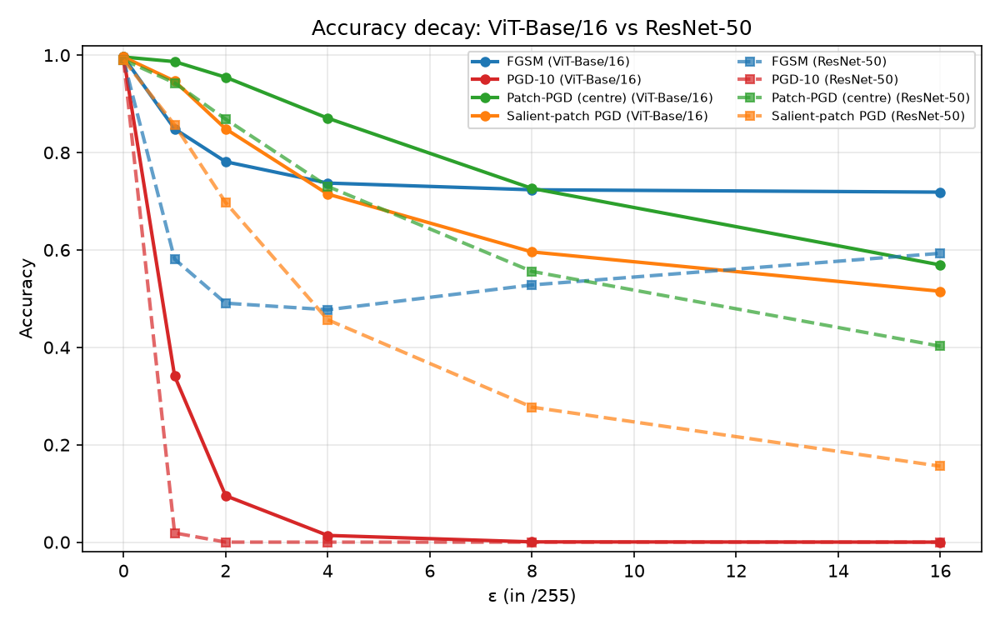
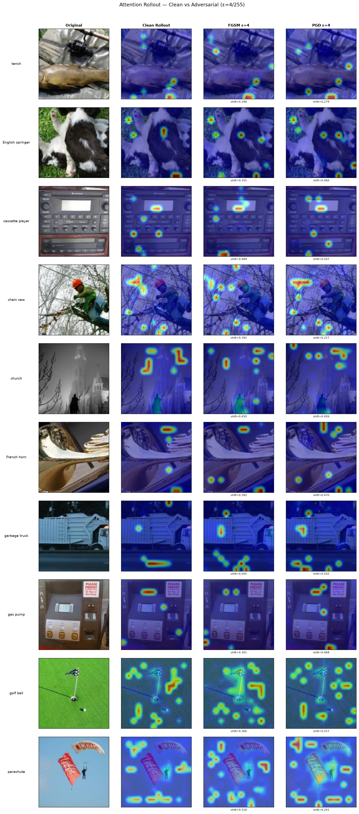
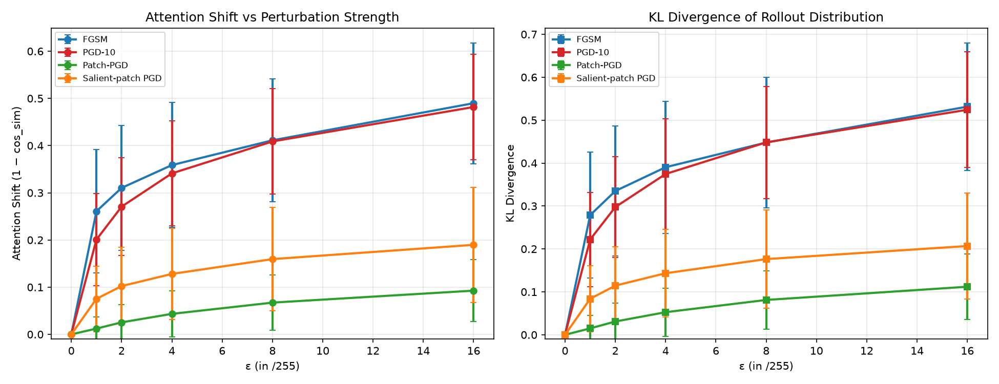
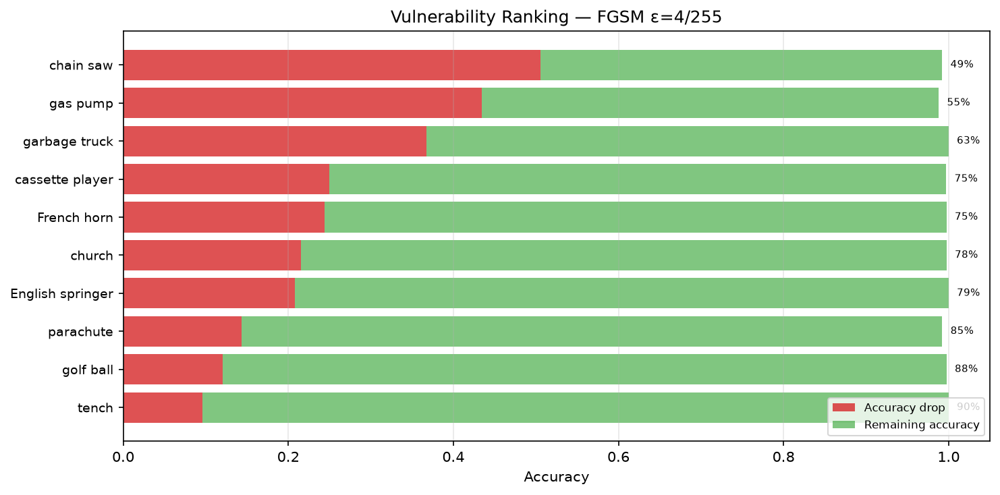
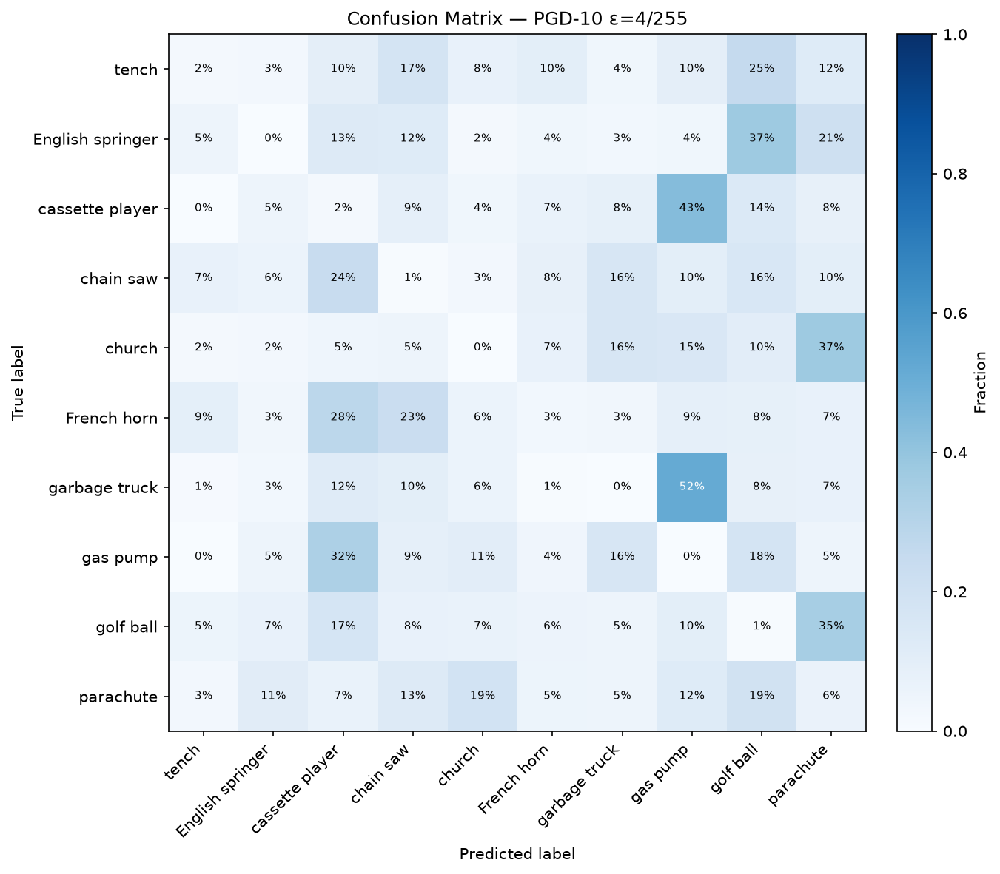
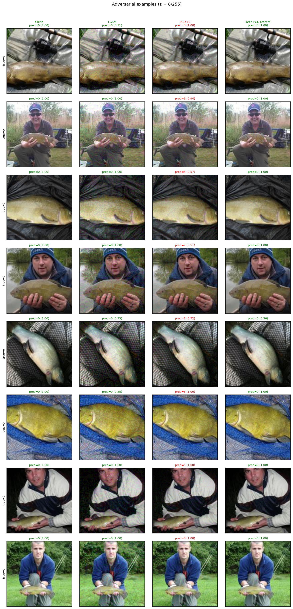

# Adversarial Decay Profile of Vision Transformers

This project measures how a pretrained ViT-Base/16, fine-tuned on Imagenette,
loses accuracy under white-box evasion attacks as the perturbation budget grows,
and compares it with ResNet-50 and ResNet-18 trained under the same conditions.
Besides accuracy, it tracks confidence and calibration, attention shift,
per-class vulnerability and transferability between architectures.

<p align="center">
  
</p>

## Main results

1. **FGSM.** The ViT drops to 74% at ε=4/255 and stays around 72% up to
   ε=16/255. The lowest accuracy of ResNet-50 is 48% and of ResNet-18 20%,
   both at ε=4/255. After that the two CNN curves go up again. PGD brings
   the same models to 0% at the same budgets, so this rise is a limit of
   the single FGSM step and not robustness.

2. **PGD-10.** All three models end up at 0%, but at different budgets. At
   ε=1/255, the smallest budget tested, ResNet-50 is at 1.9% and ResNet-18
   at 0.5%. The ViT is at 34% at ε=1/255, at 1.4% at ε=4/255 and at 0% at
   ε=16/255.

3. **Patch attacks.** When only 8-10% of the pixels can be changed, the ViT
   keeps more accuracy than the ResNets. With the salient patch at
   ε=16/255: ViT 52%, ResNet-50 16%, ResNet-18 3%.

4. **Attention.** FGSM and PGD change the attention rollout by a similar
   amount: the cosine similarity between clean and adversarial rollout is
   0.51 and 0.52 at ε=16/255. The shift does not follow accuracy: at that
   budget the ViT is still at 72% under FGSM and at 0% under PGD.

5. **Transferability.** Adversarial examples crafted on the ResNets fool
   the ViT in 0.9% of cases (effective transfer, PGD ε=8/255). Between the
   two ResNets the rate is 24-33%.

6. **Per-class differences.** Under FGSM ε=4/255, *chain saw* loses 50
   percentage points and *tench* 10.

## Results

### Accuracy vs ε

Accuracy as a function of ε for four L∞ attacks. All models are linear probes
on Imagenette trained with the same settings.

| Model | Clean | FGSM ε=4 | FGSM ε=16 | PGD ε=1 | PGD ε=4 | Salient patch ε=16 |
|---|---|---|---|---|---|---|
| ViT-B/16 | 99.6% | 73.7% | 71.9% | 34.1% | 1.4% | 51.5% |
| ResNet-50 | 99.0% | 47.7% | 59.3% | 1.9% | 0.0% | 15.6% |
| ResNet-18 | 97.6% | 19.9% | 34.2% | 0.5% | 0.0% | 3.4% |


| Attack | ViT-B/16 AUDC | ResNet-50 AUDC | ResNet-18 AUDC |
|--------|---------------|----------------|----------------|
| FGSM | 0.747 | 0.549 | 0.290 |
| PGD-10 | 0.064 | 0.032 | 0.031 |
| Patch-PGD (centre) | 0.760 | 0.617 | 0.502 |
| Salient-patch PGD | 0.656 | 0.378 | 0.240 |

AUDC is the area under the accuracy-vs-ε curve over ε ∈ [0, 16]/255,
including the clean point, computed with the trapezoidal rule and divided by
16. Higher means more robust.

Under PGD the confidence on wrong predictions is at least 0.95 for all three
models from ε=4/255. Under FGSM it stays between 0.55 and 0.75.

### Attention shift

Attention rollout heatmaps for one image per class, clean and under FGSM and
PGD at ε=4/255:

<p align="center">
  
</p>

The shift is measured as cosine similarity and KL divergence between the clean
and adversarial rollout vectors:

<p align="center">
  
</p>

| Attack | cos sim ε=4 | cos sim ε=16 |
|---|---|---|
| FGSM | 0.64 | 0.51 |
| PGD-10 | 0.66 | 0.52 |
| Patch-PGD (centre) | 0.96 | 0.91 |
| Salient-patch PGD | 0.87 | 0.81 |

FGSM and PGD, which perturb the whole image, cause large shifts. The two patch
attacks cause smaller ones, but they also change only 8-10% of the pixels. In
the clean images the rollout is already concentrated on a few patches, often
outside the object. The attacks move these peaks to other patches.

### Transferability

Effective transfer rate: among the samples that fool the source model, the
fraction that also fools the target model. Rows are sources, columns are
targets.

PGD, ε=8/255:

| Source \ Target | ViT-B/16 | ResNet-50 | ResNet-18 |
|---|---|---|---|
| ViT-B/16 | - | 4.2% | 6.1% |
| ResNet-50 | 0.9% | - | 24.1% |
| ResNet-18 | 0.9% | 33.5% | - |

FGSM, ε=8/255:

| Source \ Target | ViT-B/16 | ResNet-50 | ResNet-18 |
|---|---|---|---|
| ViT-B/16 | - | 18.2% | 22.7% |
| ResNet-50 | 4.4% | - | 34.2% |
| ResNet-18 | 2.7% | 22.1% | - |

From a CNN to the ViT the transfer rate is below 5%, between the two CNNs it
is 22-34%. On the pairs that include the ViT, FGSM transfers better than PGD.
FGSM fools only part of the samples on the source model (22-80% depending on
model and ε), so its rates are computed on a smaller set than the PGD ones.

### Per-class vulnerability

Accuracy drop per class under FGSM ε=4/255:

<p align="center">
  
</p>

Confusion matrix under PGD ε=4/255. The errors concentrate on a few target
classes, for example *garbage truck* → *gas pump* (52%) and *cassette player*
→ *gas pump* (43%):

<p align="center">
  
</p>

### Examples

Clean images and their FGSM, PGD and Patch-PGD versions at ε=8/255:

<p align="center">
  
</p>

## Setup

### Threat model

| | |
|---|---|
| Knowledge | White-box (architecture, weights, gradients) |
| Stage | Test time only, training data and weights are not modified |
| Goal | Untargeted misclassification |
| Norm | L∞, ε ∈ {1, 2, 4, 8, 16}/255 |
| Domain | Pixel space [0, 1], same budget for every model |

### Models

| Model | Params | Pretraining | Training on Imagenette | Clean acc |
|---|---|---|---|---|
| ViT-Base/16 | 86M | ImageNet-21k, fine-tuned on 1k | Linear probe | 99.6% |
| ResNet-50 | 25M | ImageNet-1k | Linear probe | 99.0% |
| ResNet-18 | 11M | ImageNet-1k | Linear probe | 97.6% |

The ViT is the timm checkpoint `vit_base_patch16_224.orig_in21k_ft_in1k`, the
ResNets use the torchvision `IMAGENET1K_V1` weights.

Training settings for all models: AdamW, lr 1e-3, weight decay 0.01, cosine
schedule, 10 epochs, batch size 64, seed 42.

Every model takes [0, 1] pixels and applies the input normalisation of its
own pretraining inside the forward pass (mean and std 0.5 for the ViT,
ImageNet mean and std for the ResNets). Attacks, clipping and transfer all
work on the same pixels. During the linear probe the backbone stays in eval
mode, so the BatchNorm statistics of the ResNets are not updated, and
`scripts/train.py` checks at the end that all backbone weights and buffers
are unchanged.

### Attacks

| Name | Description |
|---|---|
| FGSM | Single step (Goodfellow et al., 2014) |
| PGD-10 | 10 steps, α=ε/4, random start (Madry et al., 2017) |
| Patch-PGD | PGD restricted to a 64×64 centre patch (about 8% of the pixels) |
| Salient-patch PGD | PGD restricted to the 20 ViT patches with the largest gradient norm (about 10% of the pixels) |

### Metrics

- Top-1 accuracy
- Mean confidence on correct and wrong predictions
- ECE (15 bins) and NLL
- Attention shift (cosine similarity and KL divergence of rollout vectors)
- Effective transfer rate
- Per-class accuracy and confusion matrices

## Reproducing the results

```bash
pip install -r requirements.txt
```

Tested on Linux with PyTorch 2.11 (ROCm 7.2) and timm 1.0.31 on an AMD
RX 6900 XT (16 GB).

```bash
# 1. Imagenette
mkdir -p data && cd data
wget https://s3.amazonaws.com/fast-ai-imageclas/imagenette2-160.tgz
tar xzf imagenette2-160.tgz && cd ..

# 2. Training (about 10 minutes in total)
python scripts/train.py --config configs/default.yaml
python scripts/train.py --config configs/resnet50.yaml
python scripts/train.py --config configs/resnet18.yaml

# 3. Evaluation under attack
#    checkpoints are saved as experiments/train/<model>/<timestamp>/model.pt
python scripts/evaluate.py --config configs/default.yaml --checkpoint <ckpt>
python scripts/evaluate.py --config configs/resnet50.yaml --checkpoint <ckpt>
python scripts/evaluate.py --config configs/resnet18.yaml --checkpoint <ckpt>

# 4. Analyses
python scripts/attention_analysis.py --config configs/default.yaml --checkpoint <ckpt>
python scripts/per_class_analysis.py --config configs/default.yaml --checkpoint <ckpt>
python scripts/transferability.py --config configs/default.yaml \
    --models "vit:configs/default.yaml:<vit_ckpt>" \
             "resnet50:configs/resnet50.yaml:<r50_ckpt>" \
             "resnet18:configs/resnet18.yaml:<r18_ckpt>"

# 5. Figures
python scripts/visualize.py --metrics <vit_metrics> --metrics-2 <r50_metrics> \
    --label-1 "ViT-Base/16" --label-2 "ResNet-50" --out-dir figures/vit_vs_resnet50
```

`notebooks/results.ipynb` goes through all the results.

## Repository layout

```
configs/      one YAML per model (default.yaml is the ViT)
src/          models, attacks, data loading, evaluation, attention rollout
scripts/      entry points for training, evaluation, analyses and plots
notebooks/    results notebook
experiments/  run outputs (CSV and metadata), one folder per run
figures/      generated plots
```

## Limitations

- One dataset (Imagenette, 10 classes).
- One ViT variant (ViT-Base/16).
- The ViT was pretrained on ImageNet-21k and the ResNets on ImageNet-1k.
  Differences between the models can come from the pretraining data as well
  as from the architecture.
- Linear probe only: the backbone is frozen, so the results describe the
  pretrained features.
- No defences are evaluated.
- Untargeted attacks only.
- PGD uses 10 steps. Stronger attacks such as CW or AutoAttack would give
  tighter robustness estimates.

## License

[MIT](LICENSE)
