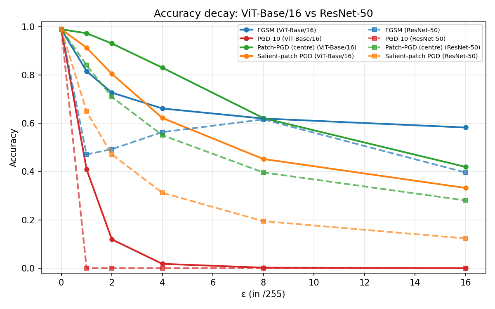
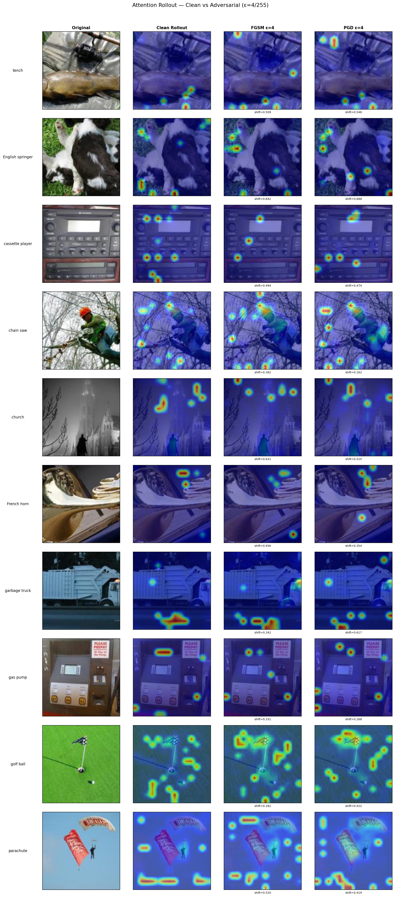
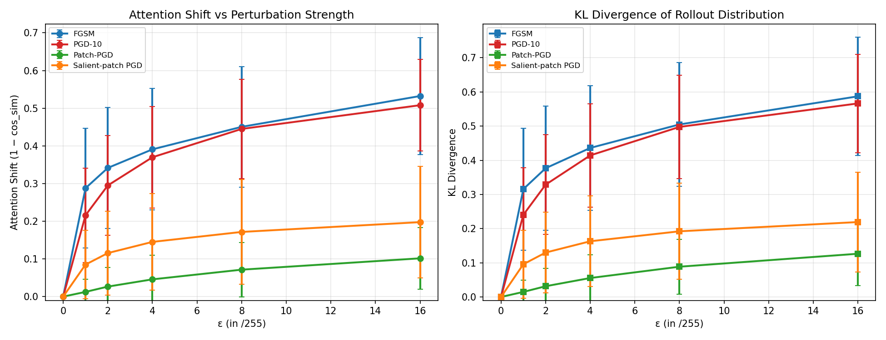
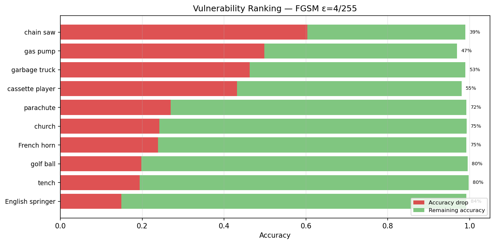
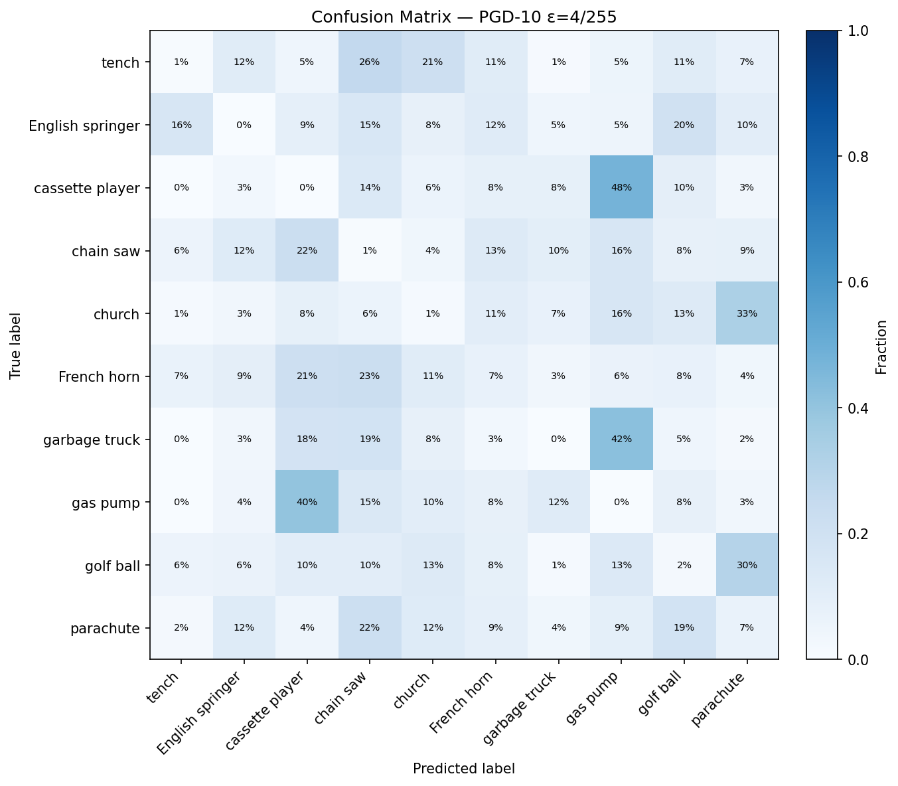

# Adversarial Decay Profile of Vision Transformers

[](https://www.python.org/)
[](https://pytorch.org/)
[](LICENSE)

**How does a pretrained ViT degrade under gradient-based evasion attacks — and how does it compare to CNNs?**

This project measures the *shape* of adversarial degradation on ViT-Base/16
(fine-tuned on Imagenette), going beyond a single accuracy number to characterise
accuracy, confidence, attention shift, per-class vulnerability, and cross-architecture
transferability as perturbation strength increases.

<p align="center">
  
</p>

## Key findings

1. **ViT degrades more gracefully than CNNs under single-step attacks.**
   Under FGSM, ViT retains 58% accuracy at ε=16/255 while ResNet-50 drops to
   40% and ResNet-18 to 29%. The ViT decay curve is smooth and monotonic; both
   CNNs exhibit non-monotonic FGSM curves (accuracy *increases* at intermediate ε),
   a hallmark of gradient masking from rough loss surfaces.

2. **Under iterative PGD, all architectures collapse — but ViT buys time.**
   PGD-10 drives ResNet-50 and ResNet-18 to 0% accuracy at ε=1/255 (the smallest
   perturbation tested). ViT still holds 41% at that budget, reaching 0% only at
   ε=16/255 — a dramatically more gradual collapse.

3. **Adversarial attacks redirect ViT attention away from the object.**
   Attention rollout heatmaps show that PGD redistributes the CLS token's attention
   from the foreground object to background regions. This shift is quantifiable:
   cosine similarity between clean and adversarial rollout drops to ~0.49 at
   ε=16/255, with FGSM producing even larger shifts than PGD at equal ε.

4. **Cross-architecture adversarial transfer is near-zero.**
   Adversarial examples crafted on ResNet-50 fool the ViT only 1.3% of the time
   (effective transfer, PGD ε=8/255). In contrast, ResNet-50 → ResNet-18 transfer
   reaches 26%. This is direct evidence that ViTs and CNNs learn structurally
   different decision boundaries.

5. **Per-class vulnerability spans a 4x range.**
   Under FGSM ε=4/255, *chain saw* drops 60 percentage points while
   *English springer* drops only 15pp. Classes with localised, high-frequency
   discriminative features are most vulnerable; classes with distributed,
   redundant features resist best.

## Results

### Accuracy decay curves

The core result: accuracy as a function of perturbation budget ε across four
L∞ attack families, comparing ViT-Base/16 against ResNet-50 and ResNet-18
(all linear-probe fine-tuned on Imagenette under identical conditions).

| Attack | VB16 AUDC | R50 AUDC | R18 AUDC |
|--------|-----------|----------|----------|
| FGSM | 0.635 | 0.530 | 0.317 |
| PGD-10 | 0.030 | 0.000 | 0.000 |
| Patch-PGD (centre) | 0.652 | 0.442 | 0.327 |
| Salient-patch PGD | 0.505 | 0.242 | 0.107 |

> AUDC = Area Under the Decay Curve (higher = more robust). Computed via
> trapezoidal integration over ε, normalised to [0, 1].

### Attention shift under attack

ViT's explicit attention mechanism allows direct visualisation of *where the
model looks* before and after perturbation. The grid below shows attention
rollout heatmaps for one image per Imagenette class under clean, FGSM, and
PGD conditions (ε=4/255):

<p align="center">
  
</p>

The attention shift is quantified via cosine similarity between clean and
adversarial rollout vectors (1.0 = identical, 0.0 = orthogonal):

<p align="center">
  
</p>

Full-image attacks (FGSM, PGD) produce large attention shifts; spatially
constrained attacks (Patch-PGD, Salient-patch PGD) produce minimal shift,
confirming that the ViT's attention is robust to localised corruption.

### Cross-architecture transferability

Effective transfer rate: of the samples that fool the source model, what
fraction also fools the target?

**PGD ε=8/255:**

| Source ↓ \ Target → | VB16 | ResNet-50 | ResNet-18 |
|---|---|---|---|
| **VB16** | — | 6.4% | 9.7% |
| **ResNet-50** | **1.3%** | — | **25.9%** |
| **ResNet-18** | **1.5%** | **26.5%** | — |

**FGSM ε=8/255:**

| Source ↓ \ Target → | VB16 | ResNet-50 | ResNet-18 |
|---|---|---|---|
| **VB16** | — | 22.2% | 30.3% |
| **ResNet-50** | **4.7%** | — | **43.1%** |
| **ResNet-18** | **3.1%** | **25.0%** | — |

CNN → CNN transfer is moderate (26-43%), CNN → ViT is negligible (1-5%),
and FGSM transfers better than PGD across all pairs.

### Per-class vulnerability

Not all classes degrade equally. Under FGSM ε=4/255:

<p align="center">
  
</p>

Under PGD ε=4/255, the confusion matrix reveals that misclassifications are
*not random* — specific confusion pairs emerge consistently:

<p align="center">
  
</p>

### Qualitative examples

Clean images alongside their FGSM, PGD, and Patch-PGD adversarial variants
at ε=8/255. Perturbations are imperceptible but predictions change:

<p align="center">
  
</p>

## Method

### Threat model

| Property | Setting |
|---|---|
| Adversary knowledge | **White-box**: full access to architecture, weights, gradients |
| Attack surface | **Test-time only** (evasion); training data and weights are unmodified |
| Objective | **Untargeted misclassification** |
| Perturbation norm | L∞, ε ∈ {1, 2, 4, 8, 16}/255 |
| Perturbation domain | Pixel space [0, 1], clipped before ImageNet normalisation |

### Models

| Model | Params | Pretrained on | Fine-tuned on | Strategy | Clean acc |
|---|---|---|---|---|---|
| ViT-Base/16 | 86M | ImageNet-21k → 1k | Imagenette (10 classes) | Linear probe | 98.9% |
| ResNet-50 | 25M | ImageNet-1k | Imagenette | Linear probe | 98.9% |
| ResNet-18 | 11M | ImageNet-1k | Imagenette | Linear probe | 96.9% |

All models share identical training conditions: AdamW, lr=1e-3, cosine
schedule, 10 epochs, batch size 64, seed 42.

### Attacks

| Name | Type | Description |
|---|---|---|
| FGSM | Single-step L∞ | Goodfellow et al., 2014 |
| PGD-10 | Multi-step L∞ | Madry et al., 2017; α=ε/4, random start |
| Patch-PGD | Region-constrained L∞ | PGD inside a 64×64 centre patch (~8% of pixels) |
| Salient-patch PGD | Gradient-guided L∞ | PGD on top-20 ViT patches by gradient norm (~10% of pixels) |

### Metrics

- **Accuracy** (top-1) as a function of ε
- **Average confidence** on correct and wrong predictions
- **ECE** (15-bin Expected Calibration Error)
- **NLL** (negative log-likelihood)
- **Attention shift** (cosine similarity and KL divergence of rollout vectors)
- **Effective transfer rate** (fraction of source-fooled samples that also fool target)
- **Per-class accuracy** breakdown and confusion matrices

## Reproducing results

### Environment

```bash
pip install -r requirements.txt
```

Tested on Linux with ROCm 7.2, AMD RX 6900 XT 16 GB. Should work on any
PyTorch-compatible GPU with ≥8 GB VRAM.

### Run the full pipeline

```bash
# 1. Download Imagenette
mkdir -p data && cd data
wget https://s3.amazonaws.com/fast-ai-imageclas/imagenette2-160.tgz
tar xzf imagenette2-160.tgz && cd ..

# 2. Train all models (~10 min total)
python scripts/train.py --config configs/default.yaml
python scripts/train.py --config configs/resnet50.yaml
python scripts/train.py --config configs/resnet18.yaml

# 3. Evaluate under attacks (replace <ckpt> with actual checkpoint paths)
python scripts/evaluate.py --config configs/default.yaml --checkpoint <ckpt>
python scripts/evaluate.py --config configs/resnet50.yaml --checkpoint <ckpt>
python scripts/evaluate.py --config configs/resnet18.yaml --checkpoint <ckpt>

# 4. Run analyses
python scripts/attention_analysis.py --config configs/default.yaml --checkpoint <ckpt>
python scripts/per_class_analysis.py --config configs/default.yaml --checkpoint <ckpt>
python scripts/transferability.py --config configs/default.yaml \
    --models "vit:configs/default.yaml:<vit_ckpt>" \
             "resnet50:configs/resnet50.yaml:<r50_ckpt>" \
             "resnet18:configs/resnet18.yaml:<r18_ckpt>"

# 5. Generate figures
python scripts/visualize.py --metrics <vit_metrics> --metrics-2 <r50_metrics> \
    --label-1 "ViT-Base/16" --label-2 "ResNet-50" --out-dir figures/vit_vs_resnet50
```

An interactive walkthrough of all results is also available in
[`notebooks/results.ipynb`](notebooks/results.ipynb).

## Project structure

```
vit-evasion-decay/
├── configs/
│   ├── default.yaml               # ViT-Base/16 linear probe
│   ├── resnet50.yaml              # ResNet-50 linear probe
│   └── resnet18.yaml              # ResNet-18 linear probe
├── src/
│   ├── __init__.py                # Unified model factory (build_model)
│   ├── models.py                  # ViT loading via timm
│   ├── cnn_models.py              # ResNet loading via torchvision
│   ├── attacks.py                 # FGSM, PGD, patch-based variants
│   ├── eval.py                    # Evaluation loops + per-class analysis
│   ├── attention.py               # Attention rollout extraction + metrics
│   ├── data.py                    # Imagenette loaders, denorm/renorm
│   └── utils.py                   # Seed, I/O, calibration metrics
├── scripts/
│   ├── train.py                   # Train any model via config
│   ├── evaluate.py                # Evaluate under all attacks
│   ├── visualize.py               # Generate decay plots + comparisons
│   ├── attention_analysis.py      # Attention rollout analysis
│   ├── per_class_analysis.py      # Per-class breakdown
│   └── transferability.py         # Cross-model transfer experiment
├── notebooks/
│   └── results.ipynb              # Interactive results walkthrough
├── experiments/                   # Timestamped run outputs (CSV + metadata)
└── figures/                       # All generated plots
```

## Limitations

- **Single dataset** (Imagenette, 10 classes). Results may not generalise to
  CIFAR-10, full ImageNet, or domain-specific data.
- **Single ViT variant** (ViT-Base/16). DeiT, Swin, BEiT, or larger ViTs may
  behave differently.
- **Linear probe only.** The backbone is frozen, so robustness reflects the
  pretrained features, not an end-to-end trained model.
- **No defences evaluated.** Adversarial training, input purification, and
  certified robustness are out of scope.
- **Untargeted attacks only.** Targeted attacks may reveal different failure modes.
- **PGD with 10 steps.** Stronger attacks (CW, AutoAttack) would provide tighter
  robustness lower bounds.

## License

This project is released under the [MIT License](LICENSE).
